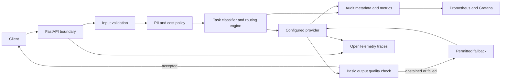

# Architecture and operating boundaries

## Decisions

- The API validates prompt length, category, image MIME type, base64 encoding,
  and image size. It never accepts an image URL, avoiding server-side fetches.
- The classifier is deterministic and accepts an explicit task type. Image
  presence overrides text classification. Routing policy maps tasks to the
  four model categories and lists permitted fallbacks.
- Provider configuration is validated at startup. Mock is the default. Ollama
  uses its `/api/generate` endpoint; cloud models use LiteLLM. Cloud credentials
  come from named environment variables. Restricted text cannot use cloud
  providers, and a restricted Ollama target must be a local hostname.
- Each cloud route uses operator supplied token prices, a prompt token
  estimate, and a bounded output token setting to enforce an estimated
  per-request cost ceiling. Actual provider billing must be reconciled
  separately.
- Basic output checks detect empty or abstaining responses. A permitted
  fallback may be tried. These checks do not establish factual correctness.
- JSON audit events include request ID, entry point, route, outcome, and token
  counts. Prompts, images, responses, and API keys are excluded. Prometheus
  labels use fixed categories, providers, routes, and outcomes. Traces do not
  include model input or output.

## Trust boundaries and known gaps

The HTTP request is untrusted. Provider responses are also untrusted and are
validated for shape and basic quality before returning. A configured provider
URL is an operator-controlled boundary. Text regexes cannot identify every
kind of PII, and image PII is not scanned. The API currently has no caller
authentication, tenant isolation, global rate limiting, durable spend ledger,
or factual answer grader. The Docker stack binds ports to localhost and is a
portfolio and local validation deployment, not an internet-facing service.

## Observability

`GET /metrics` exposes request and provider attempt counters and latency
histograms. The Grafana dashboard shows attempt outcomes, provider p95 latency,
HTTP errors, and HTTP p95 latency. `X-Request-ID` correlates a response with
metadata-only audit events. Set `OTEL_EXPORTER_OTLP_ENDPOINT` to export spans;
without it, tracing remains local and no network export is attempted.

On-call questions these signals answer:

1. Which model categories and providers fail or require fallback?
2. Is provider or HTTP p95 latency increasing?
3. Which API route is returning errors?

## Phases

| Phase | Delivered capability |
| --- | --- |
| 1 | API contracts, configuration, health checks, mock providers |
| 2 | Deterministic classification, routing policy, privacy and availability fallback |
| 3 | Ollama and LiteLLM adapters, image input, routed execution |
| 4 | PII detection, estimated cost ceiling, basic quality checks, escalation, audit |
| 5 | 130-scenario dataset, deterministic evaluation, bounded live sample runner |
| 6 | Docker stack, Prometheus/Grafana dashboard, OpenTelemetry export, CI |
